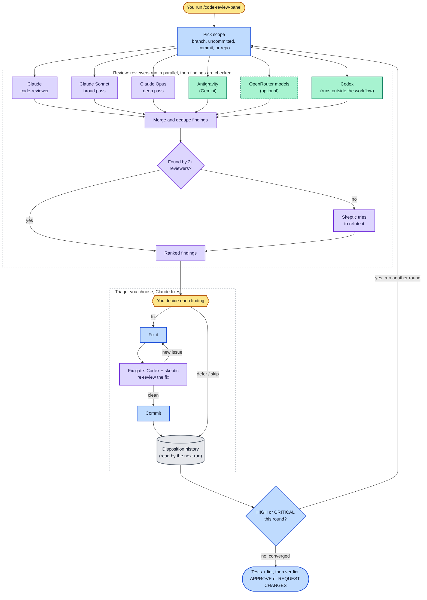

# Code Review Panel — a multi-model code-review skill for Claude Code

Run a code review as a **panel of AI reviewers** working in parallel — several Claude
models plus external reviewers (Antigravity, Codex, and optionally any OpenRouter
model) — then consolidate their findings, adversarially verify each one, and triage
the survivors with you interactively. Independent reviewers catch different bug
classes; the verification pass kills plausible-but-wrong findings before you see them.

For non-code questions, see its sibling skill [`panel`](../panel/).

## How it works



Yellow = you · Blue = main conversation · Purple = Claude agents · Green = external CLIs (dashed = optional)

Reviewers run in parallel inside a Workflow. Codex is the slowest seat, so it runs in the
background from the main conversation, and its findings join the rest at the merge. A
finding only one reviewer reported goes to a skeptic agent that tries to refute it. You
then decide each finding, and every fix passes a verification gate before it is committed. Rounds
repeat until a full panel round returns no HIGH or CRITICAL findings.

## Install

This plugin is distributed via the `eric-skills` marketplace at the root of this repo:

```
/plugin marketplace add ecwilsonaz/skills
/plugin install code-review-panel@eric-skills
```

Then invoke it in any session:

```
/code-review-panel:code-review-panel
```

### Manual install (no plugin system)

```bash
mkdir -p ~/.claude/skills/code-review-panel
cp skills/code-review-panel/SKILL.md ~/.claude/skills/code-review-panel/
```

With a manual install the skill is invoked as plain `/code-review-panel`.

## Optional external reviewers

The Claude-model reviewers work out of the box. The external panel seats need their
own tooling, and the skill degrades gracefully when one is missing:

- **Codex** — OpenAI's CLI (`codex`), pinned to `gpt-6.1-sol` at high reasoning;
  requires OpenAI authentication.
- **Antigravity** — Google's agentic IDE CLI; requires its own setup.
- **OpenRouter models** (on request) — set `OPENROUTER_API_KEY`. Note that requests go
  to third-party model providers; review OpenRouter's privacy settings.

## Fixing what the panel finds

The review is half the skill. The other half is what happens after you accept a finding,
because a fix written from a reviewer's example is the most reliable way to introduce the
next defect — three consecutive rounds of one campaign each found a defect in the previous
round's fix.

So a round does not close at "the tests pass". Before the commit, the skill runs a **fix
verification gate**:

- an **A/B blast-radius sweep** whenever the fix changes a decision function and a real
  input population exists — old code against new over the whole population, every changed
  outcome classified as an intended improvement with evidence or as a defect. A threshold
  is never calibrated from the finding's own examples; those are the cases one reviewer
  happened to hit, and the counter-population is the point of the sweep;
- **Codex over the isolated fix diff**, which covers what a data sweep structurally cannot
  see — lock lifetimes, interleavings, error-path ordering;
- **one Claude Opus 5.5 skeptic subagent** whose brief is to refute the fix by enumerating the truth table
  of every changed predicate and hunting the empty cell. The fix regressions that motivated
  this all lived in a cell nobody had named.

Gate findings are iterations inside the same round: fix, re-run the gate, then commit.
The two reviewer seats run after **every** panel fix, including doc wording, CSS, dead code,
and test-only edits. The A/B sweep applies when a decision function changed and real
input data is available. A failed reviewer leaves the gate incomplete.

Two rules exist because a whole campaign's churn traced to skipping them. **A fix that adds
a threshold, ratio, classifier or diagnosis branch is a design question wearing a bug's
clothes** — it gets the owner's rule as a written truth table before any code, because a fix
that could be written several plausible ways will be written several plausible ways, each
falsified by the next reviewer. And **a parser or text-transform fix needs a fixture captured
from a real page, with a mutation that removes the feature failing it**: one such unit was
dead in production under 4,766 green tests, because every fixture was typed by hand and none
exercised the real cleaner.

A finding that is real but outside the review's scope is not dropped and not a side note: it
becomes its own row in the disposition table, routed to whoever owns it.

## A note on cost

Each review round fans out to every panelist in parallel, and findings then get
adversarially verified — this uses substantially more tokens (and external API credits,
if configured) than a single-model review. Panel composition is decided interactively,
so you control the spend.

## Layout

```
.claude-plugin/
  plugin.json        # plugin manifest
skills/
  code-review-panel/
    SKILL.md         # the skill itself
```
